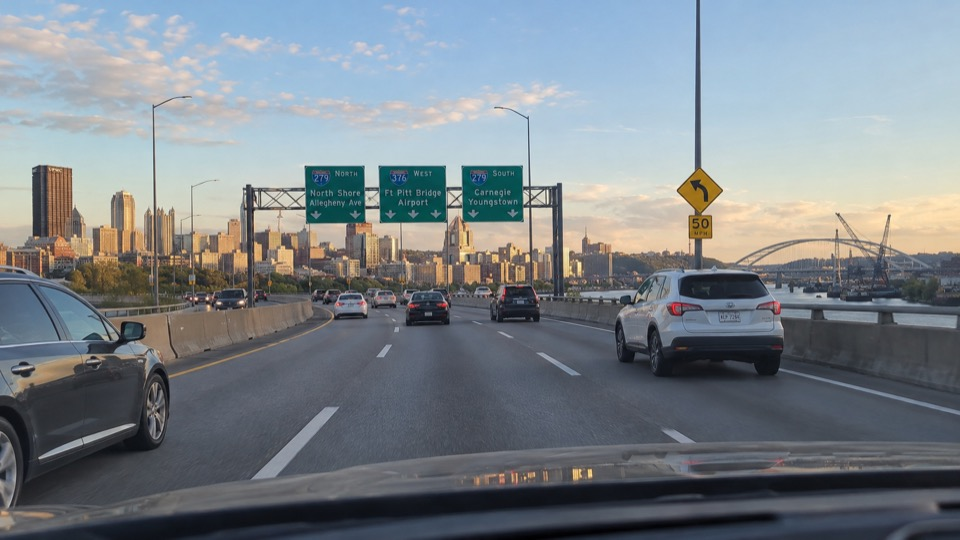
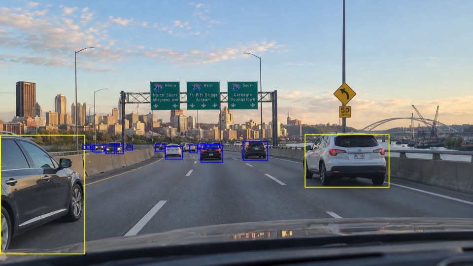
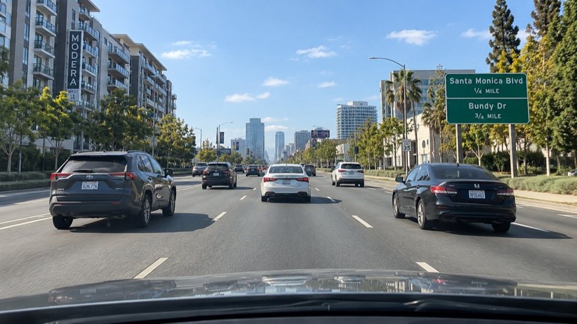
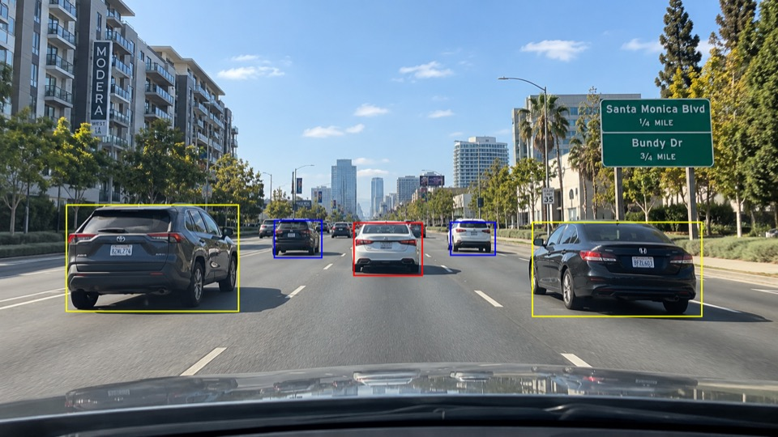
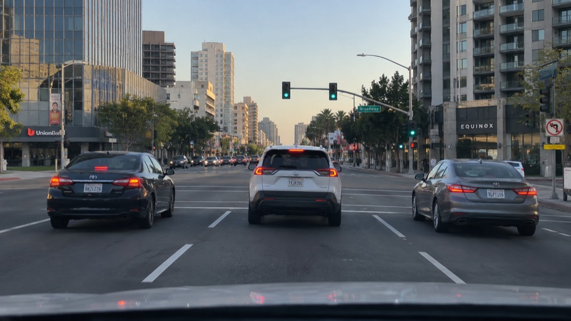
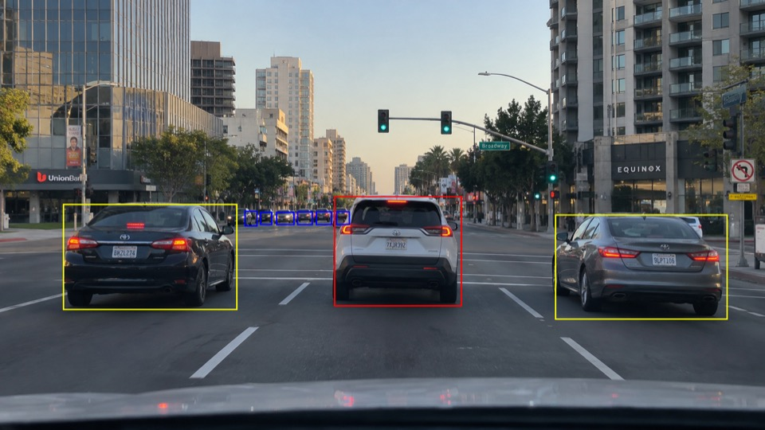

# demo-vlm-dom

ドラレコのような走行静止画に写る他車を、ローカルの VLM と DOM で解析して色付きの矩形で示すデモである。<br />
注視優先度は画像で確認できる自車の前方進路との位置関係を表し、衝突リスクの予測には使用しない。

## 準備

Mac または Ubuntu、Python 3.13、`uv`、Ollama 0.35 以降を用意する。<br />
Ollama サーバーを起動し、次のモデルをダウンロードする。

```bash
ollama pull qwen2.5vl:7b
ollama pull tev1
uv sync --locked
```

走行静止画を `data/src/` に置き、必要に応じて [setting.ini](config/setting.ini) を編集する。<br />
入力ファイルは直下の名前順に処理する。

```bash
uv run --locked demo
```

結果は `data/dest/` に入力と同じファイル名・画像形式・画素寸法で保存する。<br />
成功した画像の同名出力は上書きし、失敗した画像の出力は変更しない。<br />
一枚が失敗しても次の画像へ進み、最後に成功・失敗件数、失敗したファイル名、処理時間を表示する。<br />
車両が検出されない画像も、矩形なしで出力する。

## 判定と画像サイズ

他車が前方進路上なら「高」(赤)、進路の近くなら「中」(黄)、位置が分かりどちらにも該当しなければ「低」(青)とする。<br />
画像から位置関係を判断できない車両は「判定不能」として描画せず、理由と件数を表示する。<br />
モデルの矩形が不正な場合はその車両を除外する。<br />

VLM は自車線と各車両の位置関係・画像上の根拠を読み取り、DOM はその関係を使って判定する。<br />
遠方と判定されない車両で、自車線や前方進路との位置関係が判別できない場合は判定不能にする。<br />
画像上で小さく離れて見える車両は青枠とし、手前の車両は同じ車線なら赤枠、左右の車線なら黄枠で示す。

推論用画像は、設定した最大幅・最大高さに収まるよう縦横比を保って必要な場合だけ縮小する。<br />
小さな画像は拡大しない。<br />
VLM が返す推論用画像のピクセル座標を元画像へ換算し、元画像に描画する。

## VLM と DOM の要求・応答

以下は [実装](src/app/driving_scene_annotation/ollama_client.py)で送る英語の指示文を日本語に訳し、通信内容を説明したものである。<br />
通信上の項目名と選択値は API に合わせた英語のままとし、説明文と自由記述の例は日本語で示す。<br />
応答例は形式を示すための例であり、掲載画像から取得した実際の応答ではない。

### 初回ロード

最初の画像解析前に、VLM の `qwen2.5vl:7b` へ `/api/generate` で空の指示文を送る。<br />
画像は含めず、応答の `done` が `true` ならロード完了とみなす。<br />
DOM による最初の車両判定前には、`tev1` へ `/v1/systemone` で「応答確認のため、どちらかを選ぶ」という固定質問を送る。<br />
DOM が「応答できる」または「応答しているが前者は選ばない」のいずれかを返せば、応答確認は完了する。<br />
この選択結果は車両の優先度には使わない。

### VLM に送る画像解析要求

各画像について、縮小が必要なら縮小した画像を PNG として `/api/chat` に送り、次の内容を指示する。

- 画像に見える場面と、自車以外の識別可能な車両をすべて記述する。
- 遠方の小さな車両も含め、実在する車両ごとに一つの矩形と固有 ID を付ける。
- 画面下中央の道路標示から自車線を左・中央・右・単一車線・不明のいずれかで示す。
- 車両ごとに、自車線との関係、進路との位置関係、画像上の根拠、推論用画像での矩形座標 `[左, 上, 右, 下]` を返す。
- 位置関係が分からないときは「不明」とし、優先度、速度、意図、将来の動き、衝突可能性、正確な距離は推測しない。
- 他車が見えないときは車両一覧を空にする。

応答の `message.content` に、次の項目を持つ JSON 文字列を受け取る。<br />
座標の右端と下端は矩形に含めない。

| 項目 | 応答の形式例 |
| --- | --- |
| `scene_description` | 「片側三車線の道路に複数の車両が見える」 |
| `camera_lane` | `center` (自車線は中央) |
| `vehicles` | 車両ごとの `id`、`bbox`、`path_relation`、`evidence` の一覧 |
| `vehicles[0].id` | `v1` |
| `vehicles[0].bbox` | `[430, 260, 520, 350]` (推論用画像の画素座標) |
| `vehicles[0].path_relation` | 「自車の中央車線のすぐ前方にいる」 |
| `vehicles[0].evidence` | 「左右の車線境界線の間に車両がある」 |

### DOM に送る車両判定要求

VLM の応答を検査した後、近くに見える車両ごとに `/v1/systemone` へ一件ずつ質問を送る。<br />
要求の `state` に場面 (`scene`)、自車線 (`camera_lane`)、車両 ID (`vehicle_id`)、元画像に換算した矩形 (`bbox`)、進路との位置関係 (`path_relation`)、画像上の根拠 (`visual_evidence`) を含める。<br />
`questions` にはその車両 ID を付けた選択式の質問を一つ含める。<br />
矩形の見かけの大きさから近いと判定したことも伝え、次の基準から一つ選ぶよう指示する。

| 選択 | DOM に伝える基準 |
| --- | --- |
| 「高」(`high`) | 自車線のすぐ前方、または自車の前方進路と重なる明確な根拠があり、単に前方にいるだけでは該当しない |
| 「中」(`medium`) | 前方進路と重ならず、隣接車線または交差点の近くに見える |
| 「低」(`low`) | 位置が分かり、「高」「中」のどちらにも該当せず、対向車線も含む |
| 「判定不能」(`undetermined`) | 自車線または進路との関係が不明、あるいは画像上の根拠が足りない |

自車線と車両の車線を比較し、別の隣接車線にいる車両を、進路との重なりが明示されない限り「中」とするよう追加で指示する。<br />
対向車線の車両は「低」とし、動きや危険度は予測しない。<br />
応答の `answers` に車両 ID ごとの `choice` が入り、例えば `v1` に対して `medium` (「中」) を受け取る。

遠方に小さく見える車両は DOM に送らず「低」とする。<br />
車両の進路との関係または自車線が不明な場合も DOM に送らず「判定不能」とする。<br />
距離は推定せず、矩形の高さが元画像の高さの 8% 未満、または最も高い車両矩形の 40% 未満なら遠方と判定する。

## 出力例

入力画像と、`demo` が出力した注釈画像を並べる。<br />
元の PNG は `data/` にあり、README 用の縮小画像は `docs/images/demo-vlm-dom/` にある。

### 高速道路の走行場面

| Before (入力) | After (出力) |
| --- | --- |
|  |  |

### 複数車線の走行場面

| Before (入力) | After (出力) |
| --- | --- |
|  |  |

### 市街地の交差点 (ChatGPT 生成画像)

| Before (入力) | After (出力) |
| --- | --- |
|  |  |

## 設定

[setting.ini](config/setting.ini) の主な項目を示す。<br />
タイムアウトは秒、画像寸法と線幅はピクセル、色は `#RRGGBB` 形式である。

| 項目 | 内容 | 既定値 |
| --- | --- | --- |
| `ollama_url` | Ollama の接続先 | `http://127.0.0.1:11434` |
| `preload_timeout_seconds` | 各モデルの初回ロード用タイムアウト | `600` |
| `inference_timeout_seconds` | 画像解析・車両判定用タイムアウト | `300` |
| `keep_alive` | モデルの保持時間 | `10m` |
| `inference_max_width` | 推論用画像の最大幅 | `1280` |
| `inference_max_height` | 推論用画像の最大高さ | `720` |
| `line_width` | 矩形の線幅 | `3` |
| `high_color` / `medium_color` / `low_color` | 高・中・低の枠色 | 赤 / 黄 / 青 |

設定が不正な場合は画像処理を始めず、項目名を表示する。<br />
Ollama に接続できない場合やモデルが応答しない場合は、その画像を失敗として扱う。

## よく使う用語

| 用語 | 意味 |
| --- | --- |
| VLM | Vision Language Model。画像から他車、矩形、見える位置関係と根拠を抽出するモデル。ここでは `qwen2.5vl:7b` |
| DOM | Decision Only Model。VLM の説明から車両ごとの注視優先度を選ぶモデル。ここでは `tev1` |
| 注視優先度 | 静止画像で見える前方進路との位置関係による注視の順序。衝突可能性の予測値ではない |
| 自車線 | 画像下側の自車位置から前方に続く、画像上で確認できる走行車線 |
| 判定不能 | 前方進路との位置関係を画像から判断する根拠が足りない状態 |
| 推論用画像 | VLM に渡す、必要に応じて縮小した画像。出力画像は元画像の寸法を使う |
| OpenSpec change | 一回の変更を計画・実装・検証する成果物一式 |
| capability | 利用者に提供する、継続管理する能力の単位 |
| 能力別パッケージ | 一つの能力の CLI と処理をまとめる `src/app/<capability>/` |
| 共有契約 | 能力間で受け渡す型、保存形式、パスなどの取り決め |
| 受け入れ条件 | change が利用者の目的を満たすか判断する条件 |
| 証跡 | 検証の手順、環境、結果を後で確認できる記録 |

要件の正本は [OpenSpec 仕様](openspec/specs/driving-scene-annotation/spec.md)、受け入れ条件は [アーカイブ済みの change](openspec/changes/archive/2026-10-19-demo-vlm-dom/proposal.md) に記載している。<br />
能力と実装パッケージの対応、共有契約、依存方向は [設計](openspec/changes/archive/2026-10-19-demo-vlm-dom/design.md) に記載している。

## 開発

開発環境では Node.js と npm も用意する。<br />
必要な依存関係を同期し、品質検査を実行する。

```bash
uv sync --locked
npm ci
uv run --locked pytest
uv run --locked pre-commit run --all-files
npm run check
```

Python コードは `src/app/driving_scene_annotation/`、自動テストは `tests/` に置く。<br />
機能変更は OpenSpec change の成果物を更新してから実装する。

## 延期中の受け入れ確認

`demo-vlm-dom` の受け入れ確認タスク 5.2、5.4、5.5、5.6 は未完了である。<br />
2026-10-19 に PNG 5 枚の色分けを確認し、利用者は現状の出力を了承した。<br />
以下は未検証であり、運用開始の承認を意味しない。

| Change | AC-ID | 状態 | 未完了タスクと確認内容 |
| --- | --- | --- | --- |
| demo-vlm-dom | AC-001 | 未検証 | タスク5.2: 来歴が確かな実走行画像での三段階・枠位置・小車両の精度、旧 JPEG・AVIF・WebP の再確認、遠方小矩形の過剰検出 |
| demo-vlm-dom | AC-002 | 未検証 | タスク5.4: 無検出と根拠不足を含む実画像での枠・理由 |
| demo-vlm-dom | AC-003 | 未検証 | タスク5.5: 実モデルでの失敗後継続と失敗画像の旧出力保持 |
| demo-vlm-dom | AC-004 | 未検証 | タスク5.6: 設定変更時の実モデルでの反映 |
